<picture>
  <source media="(prefers-color-scheme: dark)" srcset="assets/banner-dark.svg" />
  <source media="(prefers-color-scheme: light)" srcset="assets/banner.svg" />
  
</picture>

  
  
  

## 👋 About me

I'm Nam. I build practical software: automation bots, internal tools and small products that save people time. I care about systems that are simple to run and honest about their trade-offs.

- 🛠️ Building **[Retec](https://retec.vn/)**, smart tools for everyday work, starting with Vietnamese-aware OCR.
- 🤖 Automating the boring parts with Python, Node.js and LLMs.

---

## 🧰 Tech stack

  
  
  
  
  
  
  
  

---

## 🚀 Retec

**[Retec](https://retec.vn/)** is a set of smart tools for everyday work.

| Product | What it does | Status |
|---|---|---|
| **[OCR](https://ocr.retec.vn/)** | Turns images and PDFs into text. Reads Vietnamese, including handwriting and formulas, and exports to Word or two-layer PDF. | Live |
| **PHOTO** | Edits text in photos and scans while keeping the original font, ink colour and layout. | Coming soon |

---

## 📈 Activity

<picture>
  <source media="(prefers-color-scheme: dark)" srcset="https://raw.githubusercontent.com/namtao/namtao/output/snake-dark.svg" />
  <source media="(prefers-color-scheme: light)" srcset="https://raw.githubusercontent.com/namtao/namtao/output/snake.svg" />
  
</picture>

---

## 💡 Open to

- Collaborating on automation, OCR and developer tools.
- Feedback and ideas for Retec products.

---

## 🤝 Connect

  
  
  
  

Prefer GitHub? [Open an issue](https://github.com/namtao/namtao/issues) or start a discussion on any repo.
